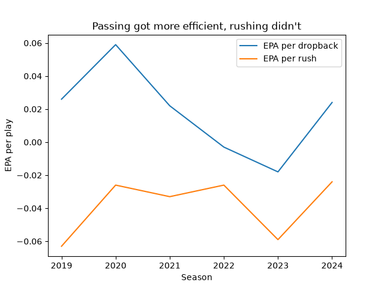

# NFL SQL Analysis

SQL analysis of 25+ seasons of NFL data with DuckDB — wins by decade, whether draft capital buys wins, all-time franchise win percentage, and the passing era.

## Questions & findings

1. **Most wins per decade** (`queries/q1_wins_by_decade.sql`) — the Colts own the 2000s (115 wins), the Patriots the 2010s (125), the Bills the 2020s so far (78).
2. **Do early draft picks buy wins?** (`queries/q2_draft_capital_vs_wins.sql`) — No. The correlation between top-100 picks in the previous 3 drafts and wins is ≈ 0 (r = −0.002). Teams loaded with recent top-100 picks average 7.97 wins vs 7.88 for teams with few.
3. **All-time franchise win %** (`queries/q3_franchise_win_pct.sql`) — the Patriots lead at .658 since 2000; the Rams rank 17th at .469. `queries/q3b_rams_rolling.sql` tracks the Rams' rolling 5-season win % from the Greatest Show on Turf peak through the rebuild to the McVay era.
4. **The passing era** (`queries/q4_passing_era.sql`) — pass rate barely moved (56% in 2000 → 58% in 2020). What changed is efficiency: EPA per dropback rose from −0.02 to +0.06 while rushing stayed flat. Passing didn't get more common — it got more lethal.



## Data

All data is free from [nflverse](https://github.com/nflverse/nflverse-data/releases):

- `games.parquet` (schedules release) — every game, 1999–2026
- `draft_picks.csv` (draft_picks release) — every pick, 1980–2026
- `play_by_play_<year>.parquet` (pbp release) — play-by-play, 1999–2026

Data files live in `data/` and are gitignored — download them from the links above. The repo contains only code.

## Setup

```bash
python -m venv .venv
.venv\Scripts\activate        # Windows
pip install duckdb pandas matplotlib
```

Download the files above into `data/`, then:

```bash
python test.py    # loads data into nfl.duckdb and runs Q1
python chart.py   # builds passing_era.png from Q4
```

## How it works

- `test.py` — loads the three tables into `nfl.duckdb` and runs a query file.
- `queries/` — one SQL file per question.
- `chart.py` — plots EPA per dropback vs EPA per rush by season.

## Notes

- Regular season only (`game_type = 'REG'`); ties count as half a win.
- Team codes change when franchises relocate (STL → LA, SD → LAC, OAK → LV), and `draft_picks` uses old PFR-style codes (GNB, KAN, NWE...). The queries map them to one code per franchise — without that, the Rams' St. Louis years silently disappear.
- The 2020s cover 2020–2026, so compare ranks within each decade, not raw totals across decades.
